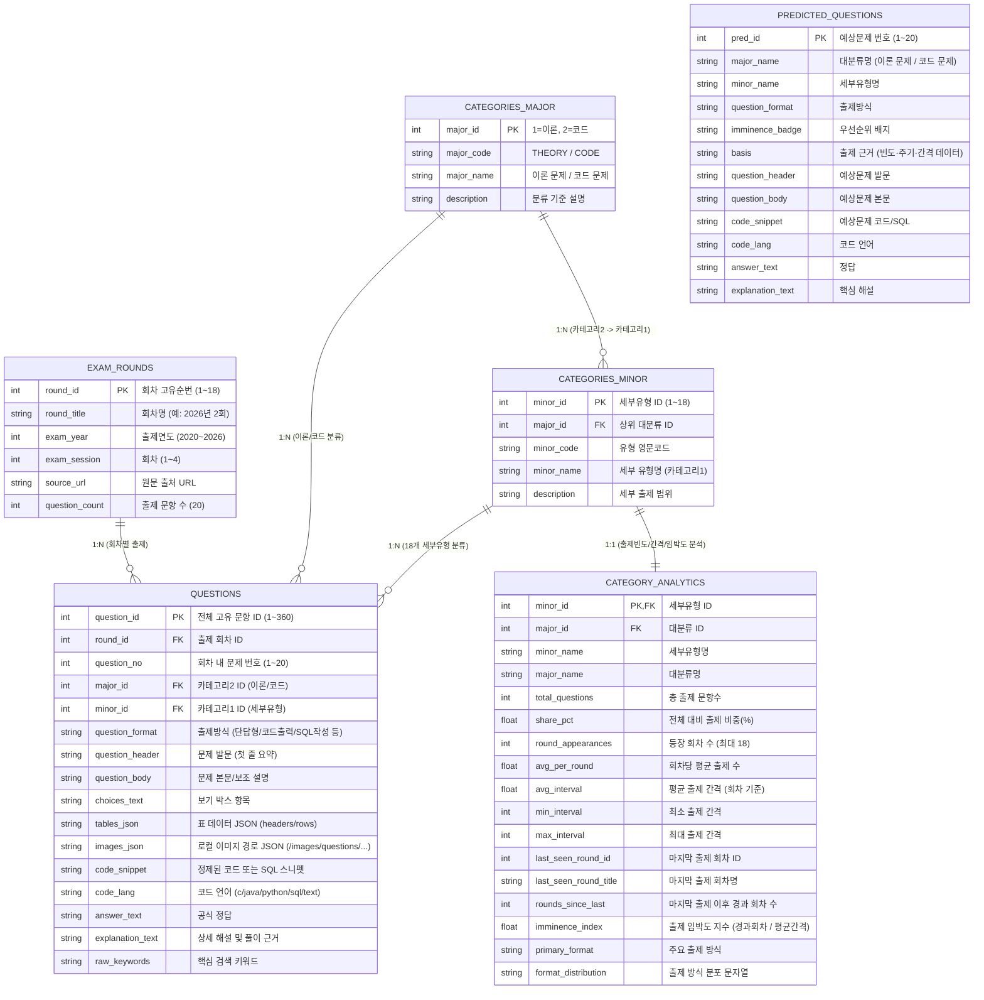

# DB Schemas — 정보처리기사 실기 기출 RDB (`data/eip_exam.db`)

본 문서는 `rebuild_clean_rdb.py`가 생성하는 정규화 SQLite 데이터베이스(`data/eip_exam.db`) 및 SQL 덤프(`data/schema_and_data.sql`)의 스키마 명세다.

## 1. 엔티티 관계도 (ERD)

## 2. 3대 학습 모드 전용 SQL View

1. **`v_mode_exam` (실전 풀이 모드)**: `answer_text`와 `explanation_text` 컬럼을 물리적으로 제외한 프로젝션 뷰.
2. **`v_mode_compare` (정답 확인 모드)**: 문제 정보 + `answer_text`까지만 포함하는 프로젝션 뷰.
3. **`v_mode_explanation` (완전 해설 모드)**: 문제 정보 + `answer_text` + `explanation_text` 전체 컬럼을 조인한 뷰.
