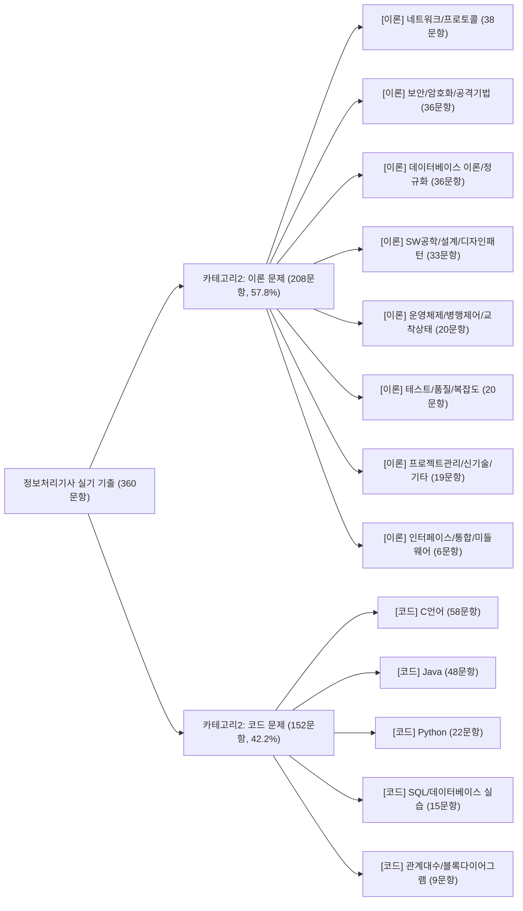

# Domain Mindmap — 정보처리기사 실기 2단계 분류 체계 및 임박도 모델

## 1. 2단계 분류 체계 (카테고리2 × 카테고리1)

## 2. 출제 임박도 지수 ($\text{Imminence Index}$) 산출 공식

각 세부 유형 $i$에 대해 등장한 회차 순번 집합을 $R_i = \{r_1, r_2, \dots, r_k\}$ ($1 \le r_j \le 18$)라 할 때:

- **평균 출제 간격 ($\text{Avg Interval}$)**:
  $$\bar{d}_i = \frac{1}{k-1} \sum_{j=1}^{k-1} (r_{j+1} - r_j)$$
- **미출제 경과 회차 ($\text{Rounds Since Last}$)**:
  $$\Delta r_i = 18 - r_k$$
- **출제 임박도 지수 ($\text{Imminence Index}$)**:
  $$I_i = \text{round}\left(\frac{\Delta r_i + 1}{\bar{d}_i}, 2\right)$$
  - $I_i \ge 1.5$: **출제 임박** (평균 주기를 초과하여 미출제된 상태)
  - $I_i = 1.0 \text{ (매회 출제 상수형)}$: **매회 필수 출제** (네트워크, 보안, DB이론, C언어, Java 등)
